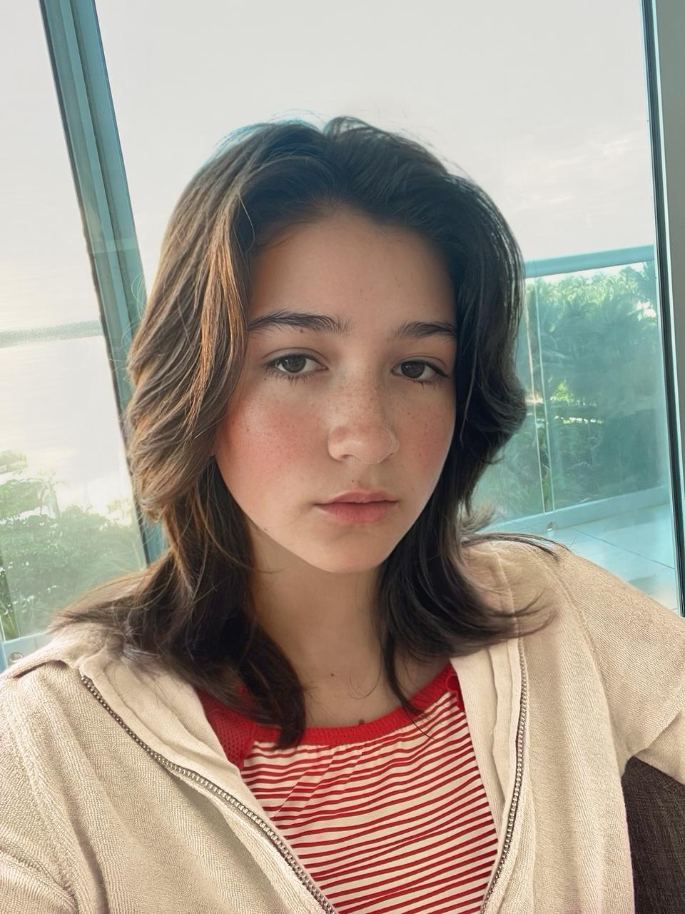

# Acerca de mí

¡Hola! Soy **Valeria Ramos Acevedo**, estudiante de **Ingeniería Mecatrónica**. Me interesa aprender cosas nuevas, entender cómo funcionan los objetos y encontrar formas creativas de resolver problemas. Me gusta combinar la parte técnica con la creatividad, por eso disfruto los proyectos en los que puedo diseñar, construir y experimentar.

## Un poco sobre mí

Fuera de la escuela, disfruto mucho estar en contacto con la naturaleza. Me gusta salir a explorar, caminar por lugares nuevos y hacer **hiking**. Para mí, recorrer un sendero es una buena forma de desconectarme un rato, observar el entorno y conocer paisajes diferentes.

También me interesan los animales, el arte, la música y todo lo que me permita descubrir nuevas ideas. Me gusta aprender tanto de temas relacionados con la tecnología como de cosas que despiertan mi curiosidad sobre el mundo.

## Lo que me gusta

- **Naturaleza y aventura:** hiking, caminatas, explorar senderos y conocer paisajes.
- **Tecnología:** aprender sobre electrónica, programación, robótica y cómo funcionan las cosas.
- **Creatividad:** diseñar, experimentar y darle un toque propio a los proyectos.
- **Animales y medio ambiente:** conocer más sobre otras especies y la importancia de cuidar nuestro entorno.
- **Música y arte:** descubrir diferentes estilos, referencias e ideas.

## Mi forma de aprender

Me gusta aprender haciendo. Creo que equivocarse, probar distintas opciones y buscar soluciones también forma parte del proceso. En este portafolio quiero mostrar no solo los resultados de mis actividades, sino también lo que fui aprendiendo y cómo fui mejorando cada proyecto.

## Algunas imágenes que me inspiran

Me gusta la sensación de explorar un lugar nuevo, especialmente cuando los caminos se pierden entre árboles y paisajes naturales.

*Fotografía: [Unsplash](https://unsplash.com/photos/map-k5rW2uVjJ4g).*

*Fotografía: [Unsplash](https://unsplash.com/photos/moss-covered-stone-archway-in-a-misty-forest-7dXgA5x4CIE).*

## Foto

