# ¿Qué es Arduino? 
Arduino es una plataforma de electrónica que utiliza una placa programable para crear diferentes proyectos. La placa tiene un microcontrolador que puede recibir información de sensores y controlar diferentes componentes, como luces, motores, botones, pantallas, etc. Se utiliza mucho para aprender programación y electrónica porque permite hacer que un programa controle objetos físicos.

## ¿Cómo se utiliza? 
Para utilizar Arduino, primero se conecta la placa a una computadora mediante un cable USB. Después, se escribe un programa en el Arduino IDE, que es el programa utilizado para programar la placa. Una vez terminado el código, se carga a Arduino y este empieza a ejecutarlo. Dependiendo de lo que se quiera hacer, se pueden conectar diferentes componentes, como un LED, un botón o un sensor. Por ejemplo, se puede programar Arduino para que cuando un sensor detecte movimiento, encienda una luz.

## Lista de materiales
### Arduino Uno
Foto: 
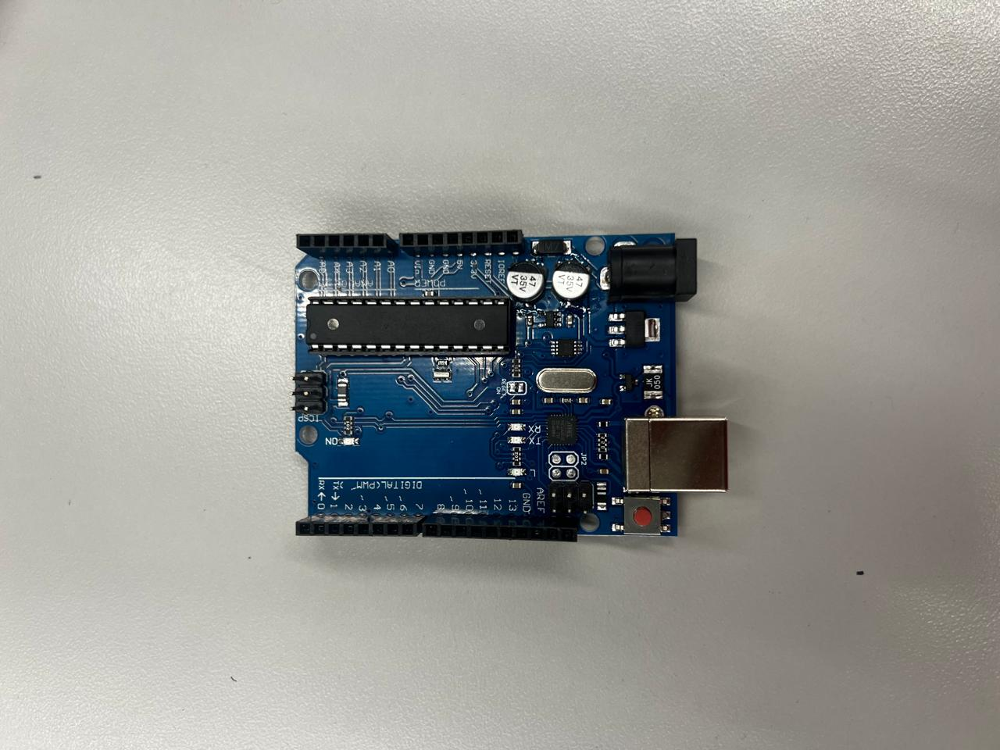
Es la placa principal. Es donde se carga el programa y que controla todos los componentes conectados.

### Protoboard (Breadboard)
Foto: 
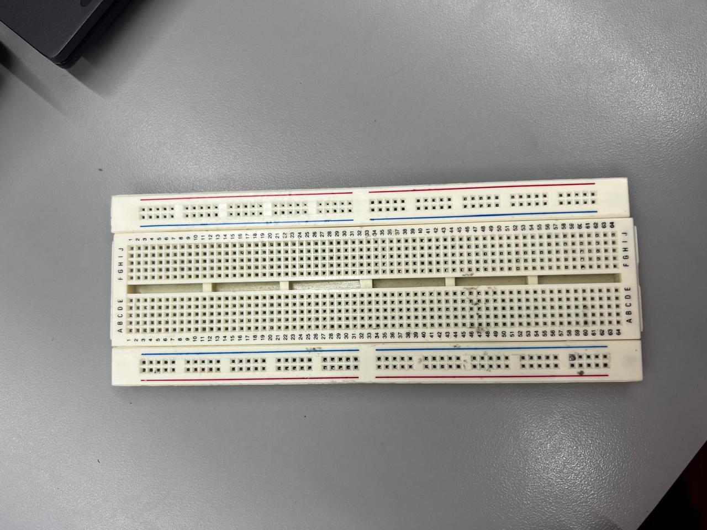
Es una placa que permite conectar componentes sin tener que soldarlos. Sirve para armar y probar circuitos fácilmente.

### Cable USB tipo A-B
Foto:
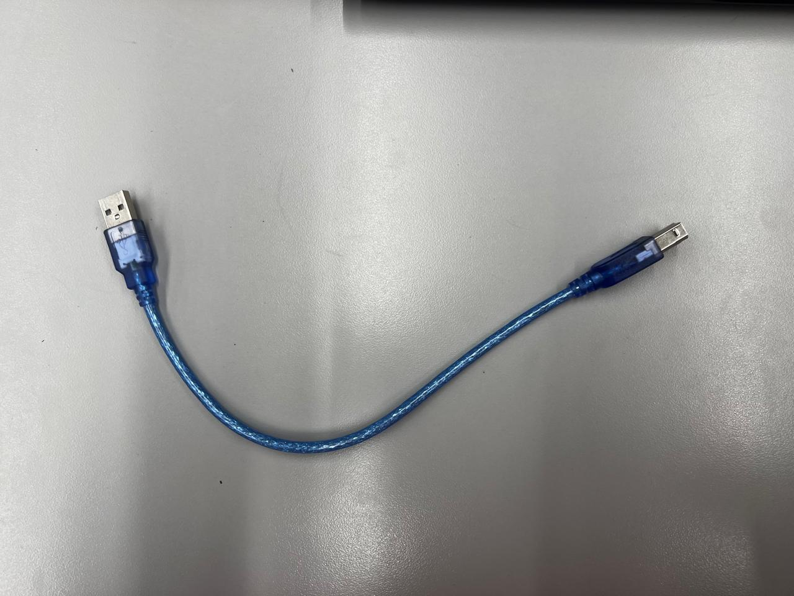
Sirve para conectar una placa Arduino a la computadora y cargarle el programa. El extremo USB-A se conecta a la computadora y el USB-B a la placa, siempre que esta tenga ese tipo de puerto. 

### Cables de conexión para fuente de alimentación
Foto: 
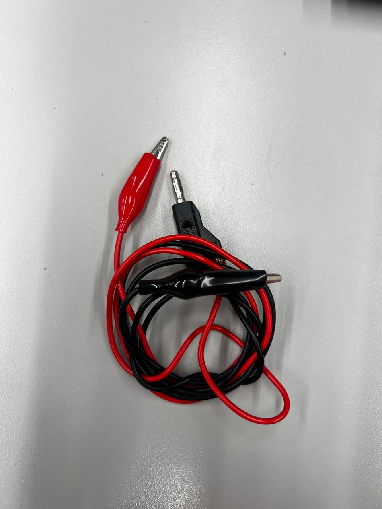
Estos cables permiten conectar una fuente de alimentación a un circuito para suministrarle energía eléctrica. Se utilizan en prácticas de electrónica para alimentar circuitos y realizar pruebas. Generalmente, el cable rojo corresponde al positivo (+) y el negro al negativo (−).

### Cables Jumper
Foto: 
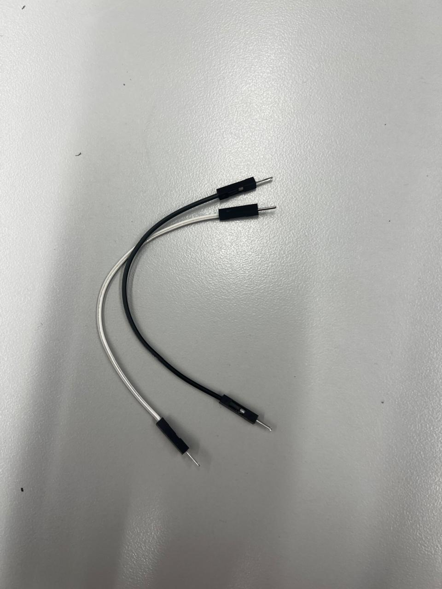
Son cables pequeños que sirven para conectar Arduino con la protoboard y los diferentes componentes.

### LED
Foto:
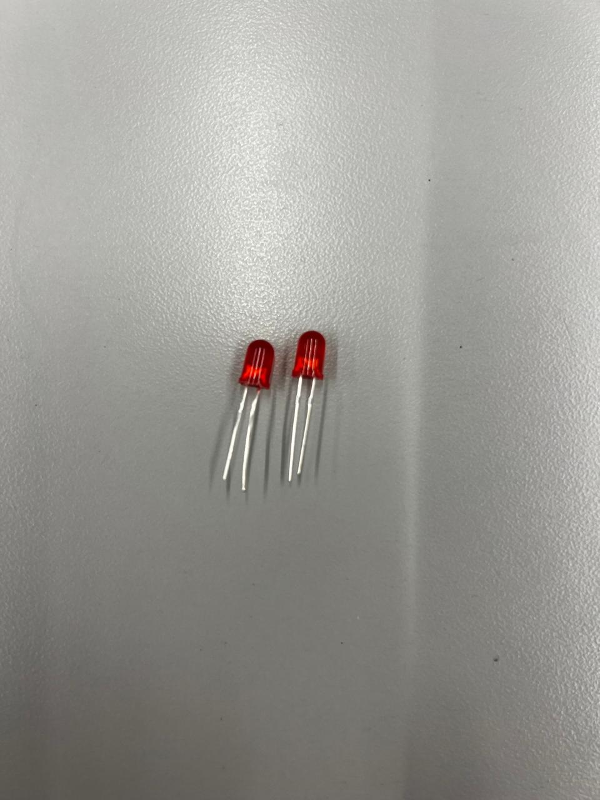
Es una pequeña luz que Arduino puede encender y apagar mediante programación. Hay LEDs de diferentes colores.

### Resistencias
Foto 220/330:
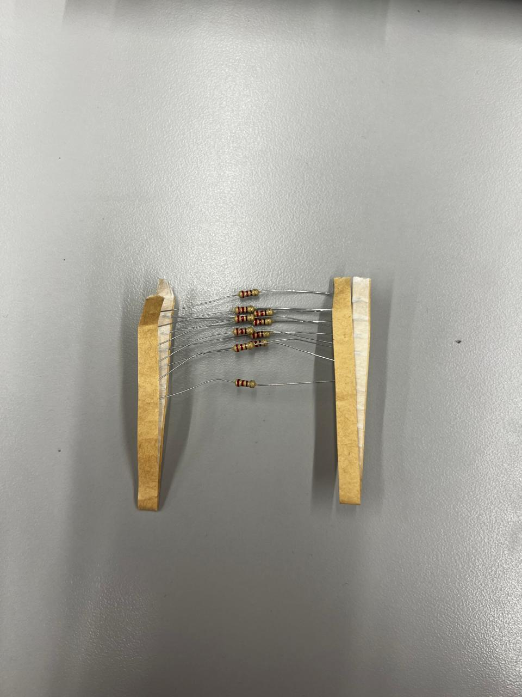
Foto 10:
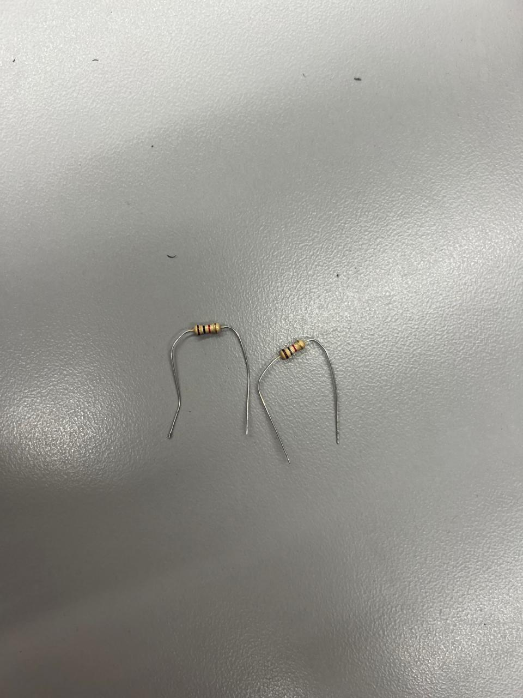
Las resistencias de 220 Ω o 330 Ω limitan la corriente eléctrica para proteger componentes como los LEDs, mientras que las de 10 kΩ se utilizan comúnmente para estabilizar las señales eléctricas de botones y sensores, evitando lecturas incorrectas.

#### Botón (Push Button)
Foto:
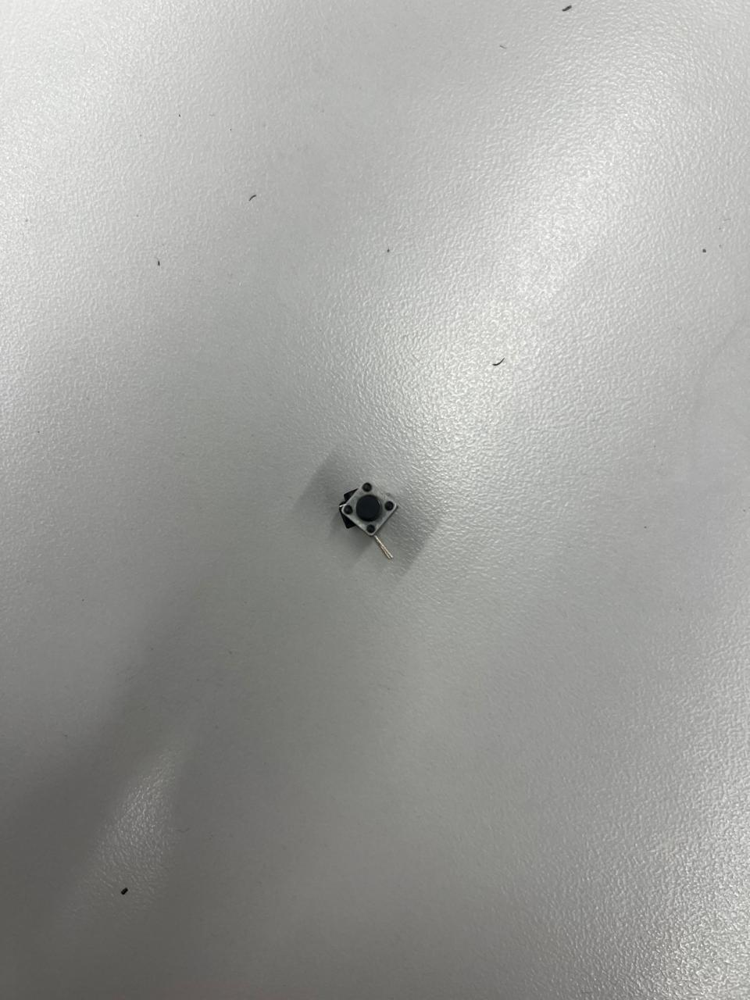
Permite enviar una señal a Arduino cuando se presiona. Por ejemplo, puedes programarlo para que al presionar el botón se encienda un LED.

### Potenciómetro
Foto:
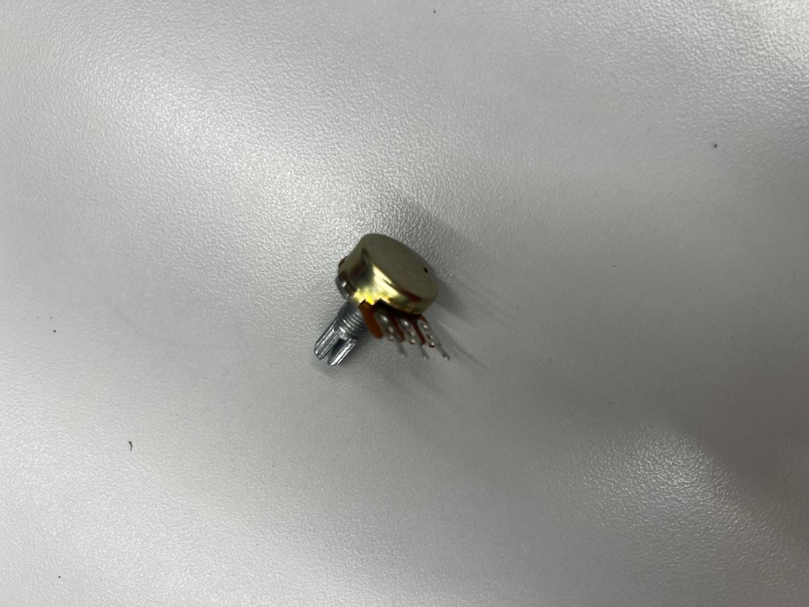
Es una resistencia que se puede ajustar manualmente. Se puede utilizar, por ejemplo, para controlar el brillo de un LED o el volumen de un sonido.

### Servomotor
Foto:
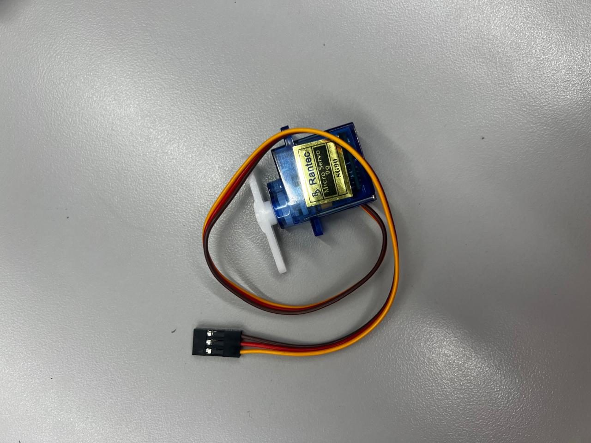
Es un motor que puede girar hasta una posición específica. Se utiliza en proyectos de robótica, puertas automáticas, brazos robóticos, etc.

### Display digital de 7 segmentos
Foto: 
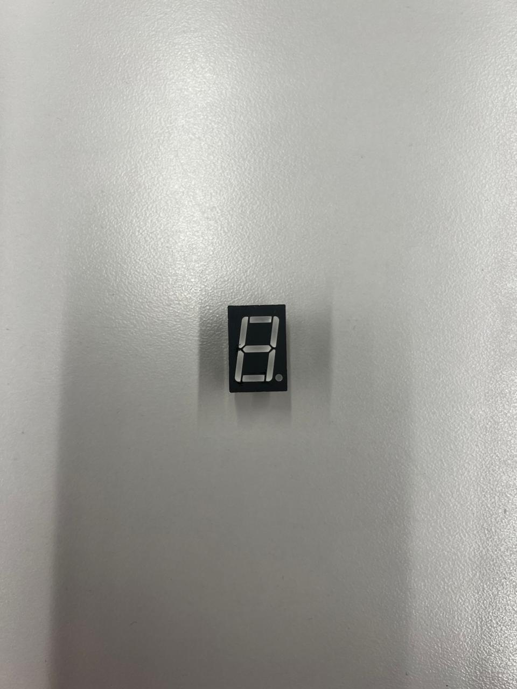
Es una pequeña pantalla formada por siete segmentos luminosos que se pueden encender en diferentes combinaciones para mostrar números del 0 al 9. Se utiliza en contadores, relojes, temporizadores y otros proyectos.

## 1_Arduino Básico Salidas Digitales
Esta primera parte abarca los fundamentos para entender cómo el Arduino manda señales hacia el exterior. Empezamos con cosas tan sencillas como hacer parpadear el LED integrado (el clásico blink) hasta controlar múltiples LEDs y displays de 7 segmentos, lo que nos sirvió para aprender a manejar voltajes, tiempos con retardos y estados lógicos (HIGH y LOW).

### 0_Ejemplo Blink
Video:
<video controls width="720">
  <source src="../portafolio-valeramosa/assets/videos/arduino/0arduino02.mp4" type="video/mp4">
</video>

### 1_Salida Digital HIGH
Video:

### 2_Salida Digital LOW
Video:

### 3_Salida Digital Delay
Video:

### 4_Salida digital led
Video:

### 5_Salida digital protoboard
Video:

### 6_Salida digital leds I
Video:

### 7_Salida digital leds II
Video:

### 8_Salida digital display 7 segmentos
Video:

### 9_Salida digital display 7 
Video:

## 2_Arduino Básico Entradas Digitales
Aquí el enfoque cambió hacia la interacción del usuario con el circuito mediante botones y pulsadores. Aprendimos a leer señales de entrada, usar estructuras condicionales (if) y aplicar compuertas lógicas como AND y OR para tomar decisiones automáticas en el código dependiendo de qué botones se presionaran.

### 10_Entrada digital boton

### 11_Entrada digital 2 botones

### 12_Entrada digital condicionales boton

### 13_Entrada digital condicionales 2 botones

### 14_Condicionales OR boton

### 15_Condicionales AND botones

### 16_Contador leds

## 3_Arduino Básico Servomotores
Esta sección fue clave porque juntó la parte lógica con el movimiento físico. Vimos cómo programar la posición de los servomotores utilizando potenciómetros como controles analógicos y la importancia de alimentar todo con una fuente externa para que el sistema fuera estable y no fallara al mover el brazo.

### 17_Servo

### 18_Servomotor varias posiciones

### 19_Servomotor y potenciometro

### 19.2_2 Servomotores y un potenciometro

### 20_2 Servomotores y 2 Potenciometros

### 21_Fuente Externa

## Conclusión General
Esta serie de prácticas con Arduino fue la base indispensable para entender cómo interactúa el software con el mundo físico. Desde prender un simple LED y leer botones hasta controlar los servomotores del brazo robot con potenciómetros y fuentes externas, cada ejercicio aportó los conocimientos electrónicos necesarios para armar y echar a andar el proyecto final sin sorpresas.
